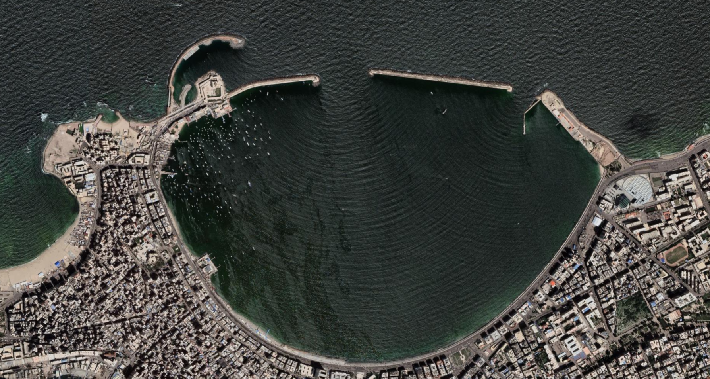
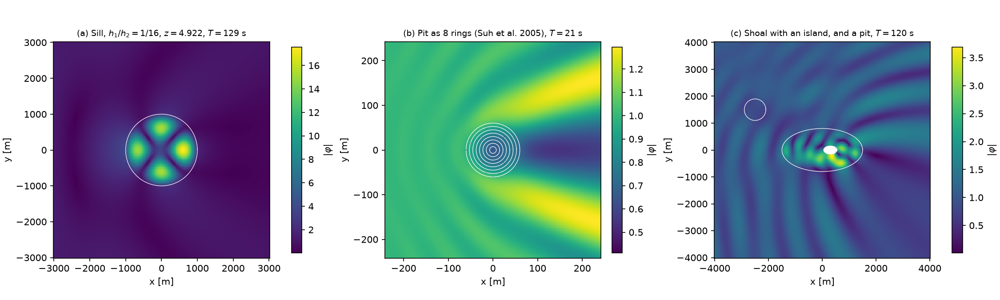

# Oh Bemn! Ocean Surface Wave Boundary Element Method

<!-- [](https://crates.io/crates/ohbemn) -->
<!-- [](https://docs.rs/ohbemn/) -->
[](https://doi.org/10.5281/zenodo.18864058)
[](https://github.com/gauteh/ohbemn/actions)
[](https://github.com/gauteh/ohbemn/actions)
[](https://pypi.org/project/ohbemn/)
<!-- [](https://anaconda.org/conda-forge/ohbemn) -->

`ohbemn` is an implementation of the Boundary Element Method based on [Kirkup
(1998)](https://www.researchgate.net/profile/Stephen-Kirkup/publication/261760562_The_Boundary_Element_Method_in_Acoustics/links/59e730b44585151e5465c4a7/The-Boundary-Element-Method-in-Acoustics.pdf) designed for simple simulations of ocean surface waves.

The Old harbour in Alexandria (with initial facilities from 1900 BC):

https://github.com/user-attachments/assets/c96d6d32-1fea-4bd2-8774-e30473bfcd2e




## Installation

1. Install dependencies: `gfortran=13` and `rust`. Can also be installed via conda/mamba after
   you have set up and activated the environment below (it may be necessary to
   symlink `gfortran` to `f95` in your conda environment to make sure `gcc` and `gfortran` match).

2. Set up and activate the conda/mamba environment:

```sh
$ mamba env create -f environment.yml
$ conda activate ohbemn
$ ln -s "${CONDA_PREFIX}/bin/gfortran" "${CONDA_PREFIX}/bin/f95"
```

3. Build and install this package into the conda/mamba environment:

```sh
$ pip install -e .
```

## Coupled subregions

`ohbemn.coupled` couples subregions of constant depth (the subregion BEM of
Brebbia & Dominguez 1992, Sect. 2.14), with continuity of the potential and the
flux `g h dphi/dn` (long waves) across shared boundaries. A boundary that
belongs to only one subregion is a wall (`alpha phi + beta dphi/dn = f`, by
default `dphi/dn = 0`).

```python
from ohbemn import coupled

rim = coupled.Boundary.circle(1000., 256)
p = coupled.Problem(T=129., subregions=[coupled.Subregion(10., outer=rim),
                                        coupled.Exterior(160., holes=[rim])])
phi = p.solve(direction=0.).field(points)
```

See `examples/coupled_regions.py` (a sill, a pit as concentric rings, and a
shoal with an island) and `python/tests/test_coupled.py` (validation against
Longuet-Higgins 1967 and Suh et al. 2005).



## Inspiration

* https://www.boundary-element-method.com/
* https://www.boundary-element-method.com/helmholtz/index.htm
* https://github.com/fjargsto/abem
* https://github.com/lzhw1991/AcousticBEM
* https://wikiwaves.org/Boundary_Element_Method_for_a_Fixed_Body_in_Finite_Depth
